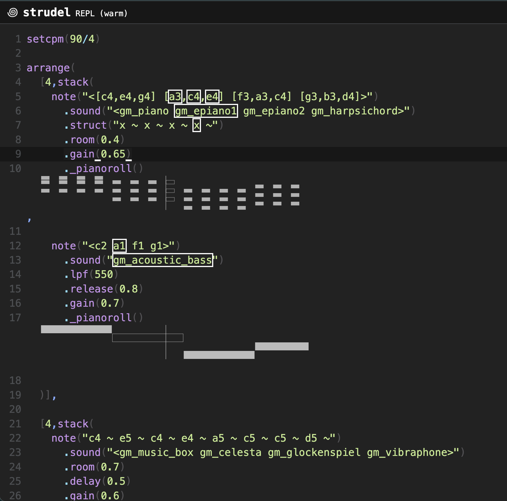

# GM Instrument Tour

A short, calm music piece built in Strudel that showcases different General MIDI instrument families over a warm C major progression.

## Listen to the Project :

**▶️ [Click here to play the track on Strudel](https://strudel.cc/#c2V0Y3BtKDkwLzQpCgphcnJhbmdlKAogIFs0LHN0YWNrKAogICAgbm90ZSgiPFtjNCxlNCxnNF0gW2EzLGM0LGU0XSBbZjMsYTMsYzRdIFtnMyxiMyxkNF0%2BIikKICAgICAgLnNvdW5kKCI8Z21fcGlhbm8gZ21fZXBpYW5vMSBnbV9lcGlhbm8yIGdtX2hhcnBzaWNob3JkPiIpCiAgICAgIC5zdHJ1Y3QoInggfiB4IH4geCB%2BIHggfiIpCiAgICAgIC5yb29tKDAuNCkKICAgICAgLmdhaW4oMC42NSkKICAgICAgLl9waWFub3JvbGwoKSwKCiAgICBub3RlKCI8YzIgYTEgZjEgZzE%2BIikKICAgICAgLnNvdW5kKCJnbV9hY291c3RpY19iYXNzIikKICAgICAgLmxwZig1NTApCiAgICAgIC5yZWxlYXNlKDAuOCkKICAgICAgLmdhaW4oMC43KQogICAgICAuX3BpYW5vcm9sbCgpCiAgICAKICApXSwKCiAgWzQsc3RhY2soCiAgICBub3RlKCJjNCB%2BIGU1IH4gYzQgfiBlNCB%2BIGE1IH4gYzUgfiBjNSB%2BIGQ1IH4iKQogICAgICAuc291bmQoIjxnbV9tdXNpY19ib3ggZ21fY2VsZXN0YSBnbV9nbG9ja2Vuc3BpZWwgZ21fdmlicmFwaG9uZT4iKQogICAgICAucm9vbSgwLjcpCiAgICAgIC5kZWxheSgwLjUpCiAgICAgIC5nYWluKDAuNikKICAgICAgLl9waWFub3JvbGwoKSwKCiAgICBub3RlKCI8IGMzIGExIGYyIGcxID4iKQogICAgICAuc291bmQoImdtX2Fjb3VzdGljX2Jhc3MiKQogICAgICAubHBmKDIwMCkKICAgICAgLnJlbGVhc2UoMC42KQogICAgICAuZ2FpbigwLjU1KQogICAgICAuX3BpYW5vcm9sbCgpCiAgKV0sCgogIFs0LHN0YWNrKAogICAgbm90ZSgiYzUgfiBlNSB%2BIGc1IH4gZTUgfiBjNSB%2BIGI0IH4gZzQgfiBlNCB%2BIikKICAgICAgLnNvdW5kKCI8Z21fbGVhZF8xX3NxdWFyZSBnbV9sZWFkXzJfc2F3dG9vdGggZ21fbGVhZF8zX2NhbGxpb3BlIGdtX2xlYWRfNl92b2ljZT4iKQogICAgICAubHBmKDE5MDApCiAgICAgIC5yb29tKDAuNikKICAgICAgLmRlbGF5KDAuNSkKICAgICAgLmdhaW4oMC4zKQogICAgICAuX3BpYW5vcm9sbCgpLAoKICAgIG5vdGUoIjxbYzMsZTMsZzNdIFthMixjMyxlM10gW2YyLGEyLGMzXSBbZzIsYjIsZDNdPiIpCiAgICAgIC5zb3VuZCgiZ21fcGFkX3N3ZWVwIikKICAgICAgLmF0dGFjaygxKQogICAgICAucmVsZWFzZSgyKQogICAgICAucm9vbSgwLjkpCiAgICAgIC5nYWluKDAuMTUpCiAgICAgIC5fcGl0Y2h3aGVlbCgpLAoKICAgIG5vdGUoIjxjMiBhMSBmMSBnMT4iKQogICAgICAuc291bmQoImdtX3N5bnRoX2Jhc3NfMSIpCiAgICAgIC5scGYoNDAwKQogICAgICAuZGVjYXkoMC4zKQogICAgICAuZ2FpbigwLjcpCiAgICAgIC5fc2NvcGUoKSwKCiAgICBzb3VuZCgiPGJkIH4gfiB%2BLCB%2BIH4gc2QgfiwgfiBoaCB%2BIGhoPiIpCiAgICAgIC5iYW5rKCJSb2xhbmRUUjgwOCIpCiAgICAgIC5nYWluKDAuMjApCiAgICAgIC5fcHVuY2hjYXJkKCkKICApXSwKCiAgWzQsc3RhY2soCiAgICBub3RlKCI8W2M0LGU0LGc0XSBbYTMsYzQsZTRdIFtmMyxhMyxjNF0gW2czLGIzLGQ0XT4iKQogICAgICAuc291bmQoIjxnbV90cnVtcGV0IGdtX3Ryb21ib25lIGdtX2ZyZW5jaF9ob3JuIGdtX2JyYXNzX3NlY3Rpb24%2BIikKICAgICAgLnN0cnVjdCgieCB%2BIHggeCB%2BIHggfiB4IikKICAgICAgLnJvb20oMC41KQogICAgICAuZ2FpbigwLjQ1KQogICAgICAuX3BpYW5vcm9sbCgpLAoKICAgIG5vdGUoIjxjMiBhMSBmMSBnMT4iKQogICAgICAuc291bmQoImdtX2Fjb3VzdGljX2Jhc3MiKQogICAgICAubHBmKDMwMCkKICAgICAgLnJlbGVhc2UoMC40KQogICAgICAuZ2FpbigwLjcpCiAgICAgIC5fcGlhbm9yb2xsKCksCgogICAgc291bmQoIjxiZCB%2BIH4gfiwgfiB%2BIHNkIH4sIH4gaGggfiBoaD4iKQogICAgICAuYmFuaygiUm9sYW5kVFI4MDgiKQogICAgICAuZ2FpbigwLjQpCiAgICAgIC5fcHVuY2hjYXJkKCkKICApXSwKCiAgWzQsc3RhY2soCiAgICBub3RlKCI8YzUgZTUgZzUgZTU%2BIDxhNCBjNSBlNSBjNT4gPGY0IGE0IGM1IGE0PiA8ZzQgYjQgZDUgYjQ%2BIikKICAgICAgLnNvdW5kKCI8Z21fdmlvbGluIGdtX3Zpb2xhIGdtX2NlbGxvIGdtX3N0cmluZ19lbnNlbWJsZV8xPiIpCiAgICAgIC5hdHRhY2soMC42KQogICAgICAucmVsZWFzZSgxKQogICAgICAucm9vbSgxLjUpCiAgICAgIC5nYWluKDAuMykKICAgICAgLl9waWFub3JvbGwoKSwKCiAgICBub3RlKCI8W2MzLGUzLGczXSBbYTIsYzMsZTNdIFtmMixhMixjM10gW2cyLGIyLGQzXT4iKQogICAgICAuc291bmQoImdtX3BhZF93YXJtIikKICAgICAgLmF0dGFjaygxLjUpCiAgICAgIC5yZWxlYXNlKDEpCiAgICAgIC5yb29tKDAuNCkKICAgICAgLmdhaW4oMC4yKQogICAgICAuX3BpdGNod2hlZWwoKSwKCiAgICBub3RlKCI8YzIgYTEgZjEgZzE%2BIikKICAgICAgLnNvdW5kKCJnbV9jb250cmFiYXNzIikKICAgICAgLmxwZig0MDApCiAgICAgIC5yZWxlYXNlKDEuNSkKICAgICAgLmdhaW4oMC40NSkKICAgICAgLl9waWFub3JvbGwoKQogICldLAoKICBbNCxzdGFjaygKICAgIG5vdGUoImM1IH4gZTUgZzUgfiBlNSBjNSB%2BIGE0IH4gYzUgZTUgfiBjNSBhNCB%2BIikKICAgICAgLnNvdW5kKCI8Z21fZmx1dGUgZ21fY2xhcmluZXQgZ21fb2JvZSBnbV9iYXNzb29uPiIpCiAgICAgIC5yb29tKDAuNikKICAgICAgLmRlbGF5KDAuOCkKICAgICAgLmdhaW4oMC44KQogICAgICAuX3BpYW5vcm9sbCgpLAoKICAgIG5vdGUoIjxbYzMsZTMsZzNdIFthMixjMyxlM10gW2YyLGEyLGMzXSBbZzIsYjIsZDNdPiIpCiAgICAgIC5zb3VuZCgiZ21fcGFkX3dhcm0iKQogICAgICAuYXR0YWNrKDAuOCkKICAgICAgLnJlbGVhc2UoMSkKICAgICAgLnJvb20oMS43KQogICAgICAuZ2FpbigwLjcpCiAgICAgIC5fcGl0Y2h3aGVlbCgpLAoKICAgIG5vdGUoIjxjMiBhMSBmMSBnMT4iKQogICAgICAuc291bmQoImdtX2Fjb3VzdGljX2Jhc3MiKQogICAgICAubHBmKDMwMCkKICAgICAgLnJlbGVhc2UoMC40KQogICAgICAuZ2FpbigwLjMgKQogICAgICAuX3BpYW5vcm9sbCgpCiAgKV0sCgogIAogIFs0LHN0YWNrKAogICAgbm90ZSgiPGM1IGU1IGc1IGU1PiA8YTQgYzUgZTUgYzU%2BIDxmNCBhNCBjNSBhND4gPGc0IGI0IGQ1IGI0PiIpCiAgICAgIC5zb3VuZCgiPGdtX3NpdGFyIGdtX2tvdG8gZ21fc2hhbWlzZW4gZ21fa2FsaW1iYT4iKQogICAgICAuc3RydWN0KCJ4IH4geCB4IH4geCB%2BIHgiKQogICAgICAucm9vbSgwLjMpCiAgICAgIC5nYWluKDAuNCkKICAgICAgLl9waWFub3JvbGwoKSwKCiAgICBub3RlKCI8YzIgYTEgZjEgZzE%2BIikKICAgICAgLnNvdW5kKCJnbV9hY291c3RpY19iYXNzIikKICAgICAgLmxwZigzMDApCiAgICAgIC5yZWxlYXNlKDAuOCkKICAgIAogICldLAoKICBbNCxzdGFjayggIAogICAgIG5vdGUoImM1IH4gZTUgfiBnNSB%2BIGU1IH4gYzUgfiBiNCB%2BIGc0IH4gZTQgfiIpCiAgICAgIC5zb3VuZCgiZ21fc3RyaW5nX2Vuc2VtYmxlXzEiKQogICAgICAuYXR0YWNrKDAuMDUpCiAgICAgIC5yZWxlYXNlKDEuNSkKICAgICAgLnJvb20oMC44KQogICAgICAuZ2FpbihzYXcucmFuZ2UoMC4yOCwgMCkuc2xvdyg0KSkKICAgICAgLl9waWFub3JvbGwoKSwKCiAgICBub3RlKCI8W2MzLGUzLGczXSBbYTIsYzMsZTNdIFtmMixhMixjM10gW2cyLGIyLGQzXT4iKQogICAgICAuc291bmQoImdtX2Nob2lyX2FhaHMiKQogICAgICAuYXR0YWNrKDEuNSkKICAgICAgLnJlbGVhc2UoMykKICAgICAgLnJvb20oMSkKICAgICAgLmdhaW4oc2F3LnJhbmdlKDAuMTUsIDApLnNsb3coNCkpCiAgICAgIC5fcGl0Y2h3aGVlbCgpLAoKICAgIG5vdGUoIjxjMiBhMSBmMSBnMT4iKQogICAgICAuc291bmQoImdtX2Fjb3VzdGljX2Jhc3MiKQogICAgICAubHBmKDQwMCkKICAgICAgLnJlbGVhc2UoMikKICAgICAgLmdhaW4oc2F3LnJhbmdlKDAuNDUsIDApLnNsb3coNCkpCiAgICAgIC5fcGlhbm9yb2xsKCksCgogICAgbm90ZSgiYzYgfiB%2BIH4iKQogICAgICAuc291bmQoImdtX3R1YnVsYXJfYmVsbHMiKQogICAgICAucm9vbSgxKQogICAgICAucmVsZWFzZSg0KQogICAgICAuZ2FpbihzYXcucmFuZ2UoMC4zLCAwKS5zbG93KDQpKQogICAgICAuX3BpYW5vcm9sbCgpCiAgKV0sCiAgCik%3D)**

---

## Description

This project is a generative music composition written in [Strudel](https://strudel.cc/), a live-coding environment for pattern-based music. The piece is structured as a guided tour through the General MIDI sound library and each section features a different instrument family (keyboards, bells, synths, brass, strings, woodwinds, world instruments, and choir) playing over a repeating I–vi–IV–V chord progression in C major (C–Am–F–G). It ends with a gentle fade-out on strings, choir, and tubular bells. The whole piece runs about 40 seconds and works as both a listenable track and a demonstration of what the GM library can do.

### Screenshots

## Getting Started

### Dependencies

- A modern web browser (Chrome, Firefox, Safari, Edge)
- No installation required — Strudel runs entirely in the browser
- An internet connection to load the Strudel REPL

### Installing

No installation needed. To run the project:

1. Open the [Strudel REPL](https://strudel.cc/) in your browser.
2. Copy the code from the "Click here to play" link above, or from the `main.js` file in this repository.
3. Paste it into the Strudel editor.

### Executing Program

- **Option 1: Click the link (easiest)**

**▶️ [Click here to play the track on Strudel](https://strudel.cc/#c2V0Y3BtKDkwLzQpCgphcnJhbmdlKAogIFs0LHN0YWNrKAogICAgbm90ZSgiPFtjNCxlNCxnNF0gW2EzLGM0LGU0XSBbZjMsYTMsYzRdIFtnMyxiMyxkNF0%2BIikKICAgICAgLnNvdW5kKCI8Z21fcGlhbm8gZ21fZXBpYW5vMSBnbV9lcGlhbm8yIGdtX2hhcnBzaWNob3JkPiIpCiAgICAgIC5zdHJ1Y3QoInggfiB4IH4geCB%2BIHggfiIpCiAgICAgIC5yb29tKDAuNCkKICAgICAgLmdhaW4oMC42NSkKICAgICAgLl9waWFub3JvbGwoKSwKCiAgICBub3RlKCI8YzIgYTEgZjEgZzE%2BIikKICAgICAgLnNvdW5kKCJnbV9hY291c3RpY19iYXNzIikKICAgICAgLmxwZig1NTApCiAgICAgIC5yZWxlYXNlKDAuOCkKICAgICAgLmdhaW4oMC43KQogICAgICAuX3BpYW5vcm9sbCgpCiAgICAKICApXSwKCiAgWzQsc3RhY2soCiAgICBub3RlKCJjNCB%2BIGU1IH4gYzQgfiBlNCB%2BIGE1IH4gYzUgfiBjNSB%2BIGQ1IH4iKQogICAgICAuc291bmQoIjxnbV9tdXNpY19ib3ggZ21fY2VsZXN0YSBnbV9nbG9ja2Vuc3BpZWwgZ21fdmlicmFwaG9uZT4iKQogICAgICAucm9vbSgwLjcpCiAgICAgIC5kZWxheSgwLjUpCiAgICAgIC5nYWluKDAuNikKICAgICAgLl9waWFub3JvbGwoKSwKCiAgICBub3RlKCI8IGMzIGExIGYyIGcxID4iKQogICAgICAuc291bmQoImdtX2Fjb3VzdGljX2Jhc3MiKQogICAgICAubHBmKDIwMCkKICAgICAgLnJlbGVhc2UoMC42KQogICAgICAuZ2FpbigwLjU1KQogICAgICAuX3BpYW5vcm9sbCgpCiAgKV0sCgogIFs0LHN0YWNrKAogICAgbm90ZSgiYzUgfiBlNSB%2BIGc1IH4gZTUgfiBjNSB%2BIGI0IH4gZzQgfiBlNCB%2BIikKICAgICAgLnNvdW5kKCI8Z21fbGVhZF8xX3NxdWFyZSBnbV9sZWFkXzJfc2F3dG9vdGggZ21fbGVhZF8zX2NhbGxpb3BlIGdtX2xlYWRfNl92b2ljZT4iKQogICAgICAubHBmKDE5MDApCiAgICAgIC5yb29tKDAuNikKICAgICAgLmRlbGF5KDAuNSkKICAgICAgLmdhaW4oMC4zKQogICAgICAuX3BpYW5vcm9sbCgpLAoKICAgIG5vdGUoIjxbYzMsZTMsZzNdIFthMixjMyxlM10gW2YyLGEyLGMzXSBbZzIsYjIsZDNdPiIpCiAgICAgIC5zb3VuZCgiZ21fcGFkX3N3ZWVwIikKICAgICAgLmF0dGFjaygxKQogICAgICAucmVsZWFzZSgyKQogICAgICAucm9vbSgwLjkpCiAgICAgIC5nYWluKDAuMTUpCiAgICAgIC5fcGl0Y2h3aGVlbCgpLAoKICAgIG5vdGUoIjxjMiBhMSBmMSBnMT4iKQogICAgICAuc291bmQoImdtX3N5bnRoX2Jhc3NfMSIpCiAgICAgIC5scGYoNDAwKQogICAgICAuZGVjYXkoMC4zKQogICAgICAuZ2FpbigwLjcpCiAgICAgIC5fc2NvcGUoKSwKCiAgICBzb3VuZCgiPGJkIH4gfiB%2BLCB%2BIH4gc2QgfiwgfiBoaCB%2BIGhoPiIpCiAgICAgIC5iYW5rKCJSb2xhbmRUUjgwOCIpCiAgICAgIC5nYWluKDAuMjApCiAgICAgIC5fcHVuY2hjYXJkKCkKICApXSwKCiAgWzQsc3RhY2soCiAgICBub3RlKCI8W2M0LGU0LGc0XSBbYTMsYzQsZTRdIFtmMyxhMyxjNF0gW2czLGIzLGQ0XT4iKQogICAgICAuc291bmQoIjxnbV90cnVtcGV0IGdtX3Ryb21ib25lIGdtX2ZyZW5jaF9ob3JuIGdtX2JyYXNzX3NlY3Rpb24%2BIikKICAgICAgLnN0cnVjdCgieCB%2BIHggeCB%2BIHggfiB4IikKICAgICAgLnJvb20oMC41KQogICAgICAuZ2FpbigwLjQ1KQogICAgICAuX3BpYW5vcm9sbCgpLAoKICAgIG5vdGUoIjxjMiBhMSBmMSBnMT4iKQogICAgICAuc291bmQoImdtX2Fjb3VzdGljX2Jhc3MiKQogICAgICAubHBmKDMwMCkKICAgICAgLnJlbGVhc2UoMC40KQogICAgICAuZ2FpbigwLjcpCiAgICAgIC5fcGlhbm9yb2xsKCksCgogICAgc291bmQoIjxiZCB%2BIH4gfiwgfiB%2BIHNkIH4sIH4gaGggfiBoaD4iKQogICAgICAuYmFuaygiUm9sYW5kVFI4MDgiKQogICAgICAuZ2FpbigwLjQpCiAgICAgIC5fcHVuY2hjYXJkKCkKICApXSwKCiAgWzQsc3RhY2soCiAgICBub3RlKCI8YzUgZTUgZzUgZTU%2BIDxhNCBjNSBlNSBjNT4gPGY0IGE0IGM1IGE0PiA8ZzQgYjQgZDUgYjQ%2BIikKICAgICAgLnNvdW5kKCI8Z21fdmlvbGluIGdtX3Zpb2xhIGdtX2NlbGxvIGdtX3N0cmluZ19lbnNlbWJsZV8xPiIpCiAgICAgIC5hdHRhY2soMC42KQogICAgICAucmVsZWFzZSgxKQogICAgICAucm9vbSgxLjUpCiAgICAgIC5nYWluKDAuMykKICAgICAgLl9waWFub3JvbGwoKSwKCiAgICBub3RlKCI8W2MzLGUzLGczXSBbYTIsYzMsZTNdIFtmMixhMixjM10gW2cyLGIyLGQzXT4iKQogICAgICAuc291bmQoImdtX3BhZF93YXJtIikKICAgICAgLmF0dGFjaygxLjUpCiAgICAgIC5yZWxlYXNlKDEpCiAgICAgIC5yb29tKDAuNCkKICAgICAgLmdhaW4oMC4yKQogICAgICAuX3BpdGNod2hlZWwoKSwKCiAgICBub3RlKCI8YzIgYTEgZjEgZzE%2BIikKICAgICAgLnNvdW5kKCJnbV9jb250cmFiYXNzIikKICAgICAgLmxwZig0MDApCiAgICAgIC5yZWxlYXNlKDEuNSkKICAgICAgLmdhaW4oMC40NSkKICAgICAgLl9waWFub3JvbGwoKQogICldLAoKICBbNCxzdGFjaygKICAgIG5vdGUoImM1IH4gZTUgZzUgfiBlNSBjNSB%2BIGE0IH4gYzUgZTUgfiBjNSBhNCB%2BIikKICAgICAgLnNvdW5kKCI8Z21fZmx1dGUgZ21fY2xhcmluZXQgZ21fb2JvZSBnbV9iYXNzb29uPiIpCiAgICAgIC5yb29tKDAuNikKICAgICAgLmRlbGF5KDAuOCkKICAgICAgLmdhaW4oMC44KQogICAgICAuX3BpYW5vcm9sbCgpLAoKICAgIG5vdGUoIjxbYzMsZTMsZzNdIFthMixjMyxlM10gW2YyLGEyLGMzXSBbZzIsYjIsZDNdPiIpCiAgICAgIC5zb3VuZCgiZ21fcGFkX3dhcm0iKQogICAgICAuYXR0YWNrKDAuOCkKICAgICAgLnJlbGVhc2UoMSkKICAgICAgLnJvb20oMS43KQogICAgICAuZ2FpbigwLjcpCiAgICAgIC5fcGl0Y2h3aGVlbCgpLAoKICAgIG5vdGUoIjxjMiBhMSBmMSBnMT4iKQogICAgICAuc291bmQoImdtX2Fjb3VzdGljX2Jhc3MiKQogICAgICAubHBmKDMwMCkKICAgICAgLnJlbGVhc2UoMC40KQogICAgICAuZ2FpbigwLjMgKQogICAgICAuX3BpYW5vcm9sbCgpCiAgKV0sCgogIAogIFs0LHN0YWNrKAogICAgbm90ZSgiPGM1IGU1IGc1IGU1PiA8YTQgYzUgZTUgYzU%2BIDxmNCBhNCBjNSBhND4gPGc0IGI0IGQ1IGI0PiIpCiAgICAgIC5zb3VuZCgiPGdtX3NpdGFyIGdtX2tvdG8gZ21fc2hhbWlzZW4gZ21fa2FsaW1iYT4iKQogICAgICAuc3RydWN0KCJ4IH4geCB4IH4geCB%2BIHgiKQogICAgICAucm9vbSgwLjMpCiAgICAgIC5nYWluKDAuNCkKICAgICAgLl9waWFub3JvbGwoKSwKCiAgICBub3RlKCI8YzIgYTEgZjEgZzE%2BIikKICAgICAgLnNvdW5kKCJnbV9hY291c3RpY19iYXNzIikKICAgICAgLmxwZigzMDApCiAgICAgIC5yZWxlYXNlKDAuOCkKICAgIAogICldLAoKICBbNCxzdGFjayggIAogICAgIG5vdGUoImM1IH4gZTUgfiBnNSB%2BIGU1IH4gYzUgfiBiNCB%2BIGc0IH4gZTQgfiIpCiAgICAgIC5zb3VuZCgiZ21fc3RyaW5nX2Vuc2VtYmxlXzEiKQogICAgICAuYXR0YWNrKDAuMDUpCiAgICAgIC5yZWxlYXNlKDEuNSkKICAgICAgLnJvb20oMC44KQogICAgICAuZ2FpbihzYXcucmFuZ2UoMC4yOCwgMCkuc2xvdyg0KSkKICAgICAgLl9waWFub3JvbGwoKSwKCiAgICBub3RlKCI8W2MzLGUzLGczXSBbYTIsYzMsZTNdIFtmMixhMixjM10gW2cyLGIyLGQzXT4iKQogICAgICAuc291bmQoImdtX2Nob2lyX2FhaHMiKQogICAgICAuYXR0YWNrKDEuNSkKICAgICAgLnJlbGVhc2UoMykKICAgICAgLnJvb20oMSkKICAgICAgLmdhaW4oc2F3LnJhbmdlKDAuMTUsIDApLnNsb3coNCkpCiAgICAgIC5fcGl0Y2h3aGVlbCgpLAoKICAgIG5vdGUoIjxjMiBhMSBmMSBnMT4iKQogICAgICAuc291bmQoImdtX2Fjb3VzdGljX2Jhc3MiKQogICAgICAubHBmKDQwMCkKICAgICAgLnJlbGVhc2UoMikKICAgICAgLmdhaW4oc2F3LnJhbmdlKDAuNDUsIDApLnNsb3coNCkpCiAgICAgIC5fcGlhbm9yb2xsKCksCgogICAgbm90ZSgiYzYgfiB%2BIH4iKQogICAgICAuc291bmQoImdtX3R1YnVsYXJfYmVsbHMiKQogICAgICAucm9vbSgxKQogICAgICAucmVsZWFzZSg0KQogICAgICAuZ2FpbihzYXcucmFuZ2UoMC4zLCAwKS5zbG93KDQpKQogICAgICAuX3BpYW5vcm9sbCgpCiAgKV0sCiAgCik%3D)**

  - The Strudel REPL will open with the code pre-loaded.
  - Press **Ctrl+Enter** (or **Cmd+Enter** on Mac) to play.

- **Option 2: Manual copy**
  - Open [strudel.cc](https://strudel.cc/).
  - Paste the code into the editor.
  - Press **Ctrl+Enter** (or **Cmd+Enter** on Mac) to play.

## Help

**No sound?**
- Make sure you've pressed **Ctrl+Enter** (or **Cmd+Enter**) after pasting the code.
- Check that your browser tab isn't muted and your system volume is up.
- Click anywhere on the page first, some browsers block audio until you interact with the page.

**Code won't run?**
- Make sure you copied the **entire** code.
- Try opening the [Strudel REPL](https://strudel.cc/) fresh and pasting again.

**Want to modify it?**
- Change `setcpm(90/4)` to adjust tempo — try `setcpm(60/4)` for slower or `setcpm(120/4)` for faster.
- Swap any `.sound("gm_...")` for another GM instrument to hear a different timbre.
- Docs: [https://strudel.cc/learn/](https://strudel.cc/learn/)

## About the Project

A short, calm piece that walks through different families of instruments, all playing a warm C major progression. It feels like flipping through a sound library set to music, ending with a gentle fade-out on strings, choir, and tubular bells.

## Instruments Used

- **Piano, Electric Piano, Harpsichord** — opening chords
- **Music Box, Celesta, Glockenspiel, Vibraphone** — delicate melody
- **Synth Leads (Square, Sawtooth, Calliope, Voice)** — electronic section
- **Trumpet, Trombone, French Horn, Brass Section** — brass section
- **Violin, Viola, Cello, String Ensemble** — string section
- **Flute, Clarinet, Oboe, Bassoon** — woodwind section
- **Sitar, Koto, Shamisen, Kalimba** — world instruments
- **Acoustic Bass, Synth Bass, Contrabass** — low end
- **Warm Pad, Sweep Pad, Choir Aahs** — harmonic beds
- **Tubular Bells** — ending shimmer
- **TR-808 Drums** — soft kick, snare, and hats

## License

This project is licensed under the [MIT License](LICENSE) — see the LICENSE.md file for details.
